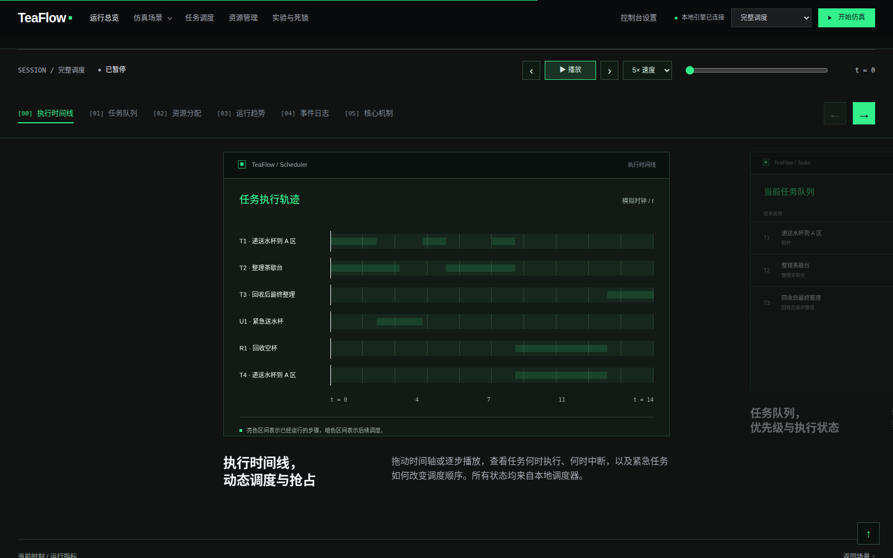

# TeaFlow OS · 茶歇服务员任务调度

任务 A 正在整理茶歇台，任务 B 因台面互斥等待；紧急送水任务 U 到达后，调度器决定何时让它执行，并保存、恢复被抢占任务的进度。本项目用 Python 离散时间仿真展示这个过程，以及资源竞争、故障中断、银行家避免和死锁检测与回滚。

课程《操作系统》期末项目；**Python 3.10+，运行程序只用标准库**。上位机为本地网页，通过真实调度器生成的快照回放。分工和验收依据为 [项目说明](docs/茶歇服务员任务调度项目说明.md)。

## 直接运行

```bash
python3 run_demo.py --scenario baseline --live --delay 0.2
python3 run_demo.py --scenario compare
python3 run_demo.py --scenario deadlock --view trace
python3 -m unittest discover -s tests -v
```

`--delay 0` 取消终端等待；`--view json` 输出完整 JSON。保存原始结果和指标表：

```bash
python3 run_demo.py --scenario baseline --output results/baseline.json --csv results/baseline.csv
python3 run_demo.py --input data/demos/basic.json --view trace
./scripts/run_experiments.sh
```

所有路径在仓库根目录执行。输入文件样例位于 `data/demos/`；[接口说明](docs/interfaces.md)给出字段、状态、事件和输出约定。

## 启动上位机

```bash
python3 dashboard_server.py
```

打开 <http://127.0.0.1:8765>。首次加载停在 `t=0`；点击“开始仿真”后自动播放，可暂停、倍速、单步、拖动时间轴。支持任务筛选、真实资源占用、策略比较、死锁三策略、结果导出和设置导入/导出。

已移植 [upper-computer-template](https://github.com/MacSwimmm/upper-computer-template) 的黑绿工作区、后台点阵、页底大字震颤和功能区局部撕裂。动效有独立开关，并响应系统“减少动态效果”；交互控件使用原生界面。默认外观见 `config.json`，浏览器保存的设置优先。详见[模板移植说明](docs/dashboard.md)。



## 已实现的核心机制

- FCFS 和优先级排序，静态初始队列与动态重排；默认无额外服务员人数限制。
- 三类分阶段任务、前置依赖、共享只读公告板、四类单实例互斥资源。
- 调度抢占保存进度并释放资源；故障/通道关闭保存进度并保留原占用，恢复后继续。
- 银行家检查、真实等待图环检测、可回滚检查点、重试时原子预留资源、重试上限和未解除状态。
- 普通/紧急请求、杯子事件去重、有限资源故障、自动恢复与显式恢复。
- 固定观察窗口 H、完成与按时完成率、完成时延、逾期、有效利用率与占用率、冲突、安全拒绝、死锁、回滚损失与实际重做量。
- 输入、配置、种子、Git 版本、源码摘要和事件轨迹随结果保存；H 时刻到达可记录，H 之后不执行。

## 验证和交付材料

本轮本地验证：52 项 Python 测试在 3.10 与 3.12 通过；21 项浏览器检查通过；20 个种子 × 5 种策略的 100 次混合负载回归通过。回归负载用于检查实现，不替代组员设计的正式课程实验。GitHub Actions 已对实现提交 `64abbe0` 在 Ubuntu 22.04/Python 3.10、Ubuntu 24.04/Python 3.12 和 Chromium 上复验，三项全部通过，见 [独立验证记录](https://github.com/MacSwimmm/26_OS/actions/runs/42493681254)；最新提交状态见 [Actions](https://github.com/MacSwimmm/26_OS/actions)。

- [韩臻浩部分审查与补齐记录](docs/review/韩臻浩部分审查与交付.md)：缺陷、修复、证据和待交接事项。
- [架构与算法说明](docs/architecture.md)、[模块与输入输出接口](docs/interfaces.md)。
- [答辩演示步骤](docs/demo.md)、[Ubuntu 运行与环境验证](docs/run_ubuntu22.md)。
- [实验口径与对照组](docs/experiments.md)、[成员分工和交接](docs/team_work.md)。

浏览器开发检查为可选步骤，需要 Node.js 22 和 Playwright：

```bash
npm ci
npx playwright install chromium
npm run test:browser
python3 -m scripts.verify_workloads
```

`BROWSER_PATH` 可指定已安装的 Chromium 系浏览器，`PYTHON_BIN` 可指定测试服务使用的解释器。应用本身无需 Node.js 或 npm。临时结果保存在 `results/`，本轮精简验收证据保存在 `docs/review/`。

## 实现范围

这是单进程离散仿真，不是 Linux 内核调度器或真实多线程程序。互斥资源限制为单实例；银行家算法采用保守最大需求，可能降低并发。默认固定小场景用于说明机制，不据此宣称策略普遍最优。完整课程交付还需要成员完成正式实验分析、教师模板报告和目标演示机器的现场验收，详见审查记录。
